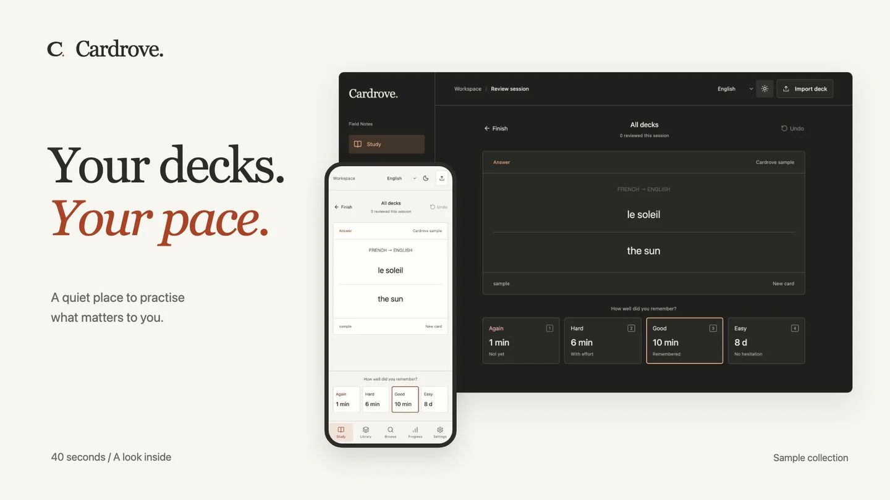
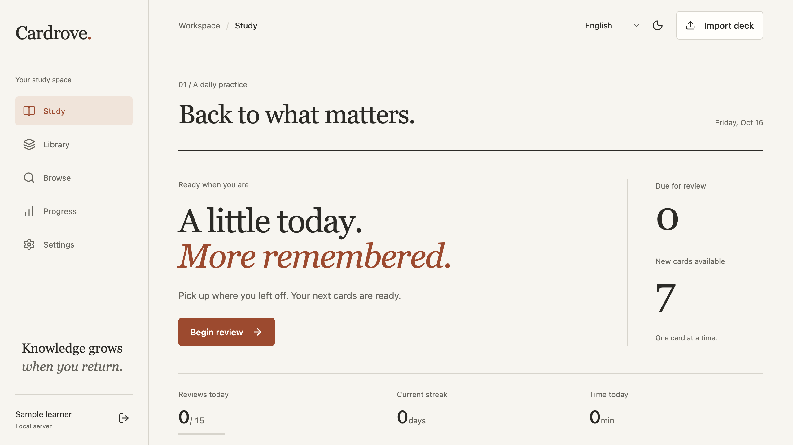
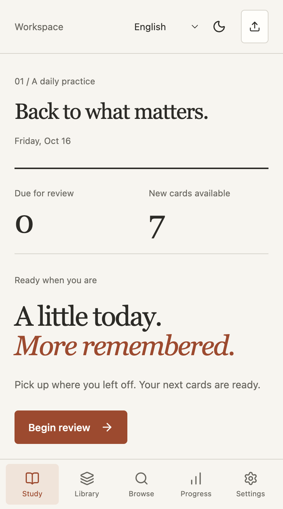

# Cardrove

**A little, remembered.** A personal home for your Anki decks, on infrastructure you control.

Import a supported `.apkg`, recall the answer, and let FSRS schedule your next review. Use a phone or computer. Run your own installation locally, or host it on Cloudflare Pages with Supabase.

[Website & handbook](https://ardanngrha.github.io/cardrove/) · [Self-hosting](https://ardanngrha.github.io/cardrove/docs/self-host/) · [Compatibility](https://ardanngrha.github.io/cardrove/docs/compatibility/)

## A look inside

[](https://ardanngrha.github.io/cardrove/media/cardrove-tour.mp4)

**[Watch the feature film](https://ardanngrha.github.io/cardrove/#feature-tour)** · [MP4](https://ardanngrha.github.io/cardrove/media/cardrove-tour.mp4)

A silent tour of importing decks, reviewing, keyboard ratings, mobile layout, and workspace controls. It uses original sample cards. The editable Remotion source and local rendering instructions live in [video/](video/). The poster above opens the video; GitHub README does not need a custom video player.

## The workspace



<details>
<summary>See the phone layout</summary>



</details>

Screenshots use disposable, original sample content. Personal decks are not included.

## What’s here

- A study interface for any subject, with English and Indonesian UI, light/dark appearance, keyboard controls, and a separate mobile layout.
- Supported Anki templates, simple cloze, furigana, images, audio, tags, and nested decks.
- FSRS review scheduling, daily new-card allowances, undo, note editing, search, and progress history.
- A cloud mode with device pairing, private media, resumable imports, and full collection backups.
- A local Node.js server with SQLite when you prefer to run everything yourself.
- First-owner setup, reusable private access codes, workspace names, progress reset, and Home Screen installation on supported browsers.

Each installation is for **one owner**. Connected devices share that owner’s entire collection and progress. This is not a shared public learning service or a multi-user classroom.

## Run locally

Requires **Node.js 24+**, npm, and Git.

```sh
git clone https://github.com/ardanngrha/cardrove.git
cd cardrove
npm ci
npm run dev
```

Open `http://localhost:4317` and enter the first-owner setup code printed in your server terminal. Enter your name and a workspace name, then copy or download your generated access code before continuing. The ignored `data/` directory holds your collection. Keep an independent backup.

For a production build:

```sh
npm run build
npm start
```

The server listens on your network by default. Set `HOST=127.0.0.1` for access from this computer only. For internet access, use an HTTPS reverse proxy you control. The development server is for local work.

## Put it online

The static app runs on **Cloudflare Pages**, with **Supabase PostgreSQL, Auth, Edge Functions, and private Storage** behind it. Every person who clones Cardrove creates their own projects. The author does not operate a central sync server.

1. Create a Supabase Free project and apply the migrations in `supabase/migrations/`.
2. Deploy the `cardrove-api` Edge Function.
3. Copy `.env.example` to `.env.cloud.local` and supply your project URL and **publishable** key. Never put a secret or service-role key in a `VITE_` variable.
4. Build with `npm run build:cloud` and deploy `dist/` to your Pages project.
5. Generate the first-device setup code with `npm run setup:cloud -- --app-url https://YOUR_APP.pages.dev`. Run `work/setup/setup.sql` in your project's SQL Editor, then open the private link in `work/setup/setup-link.txt` to connect the first device. The script creates this link locally; Cloudflare does not generate it. It works once, for 30 minutes after the SQL runs. Enter your name and workspace name, then save the generated permanent access code. Never share this code publicly.

The permanent access code connects additional devices until you replace it in Settings. Temporary five-minute QR codes remain available. Settings also lets you rename your workspace and reset study progress with a typed confirmation. Reset clears review history and schedules while keeping decks, notes, and media.

On iPhone/iPad, use Safari's Share menu and **Add to Home Screen**. On Android, use Chrome's **Install app** or **Add to Home screen**. The web manifest, C icon, and standalone display are included. Installation does not enable offline study; the service worker stores no private responses. A separate installed browser context may need its own device connection.

The [full setup guide](https://ardanngrha.github.io/cardrove/docs/self-host/) covers commands, pairing, recovery, hosting quotas, and backups. An Indonesian deployment guide is also available in [docs/DEPLOY.md](docs/DEPLOY.md).

You can start on the providers’ Free plans. Their quotas and inactivity policies apply; free hosting is not unlimited hosting. Cardrove never upgrades a plan automatically. Domain purchases and paid add-ons are optional, not required.

## Know the limits

This is an independent app, not Anki or AnkiWeb. Anki scheduling history is not imported. New decks begin with fresh scheduling.

Card JavaScript, Image Occlusion, add-ons, LaTeX, complex nested cloze, full template-filter parity, AnkiWeb synchronisation, and offline study are not supported. Custom deck styles may need adjustment on a small screen or in dark appearance.

APKG imports are capped at 512 MB, 100,000 cards, and 10,000 unique media objects per file. Browser memory may impose a lower practical limit. Cloud backup generation is capped at 450 MB of media. See [all compatibility and size limits](https://ardanngrha.github.io/cardrove/docs/compatibility/).

Deck content belongs to its authors. This repository includes no personal decks, media collection, database, production session, or connection code.

## Develop

| Command               | Purpose                                    |
| --------------------- | ------------------------------------------ |
| `npm run dev`         | Local app and API                          |
| `npm run dev:cloud`   | Frontend against your own Supabase project |
| `npm run dev:site`    | Astro landing page and handbook            |
| `npm run check`       | Svelte and TypeScript diagnostics          |
| `npm test`            | Importer, scheduling, and API tests        |
| `npm run build`       | Local app build                            |
| `npm run build:cloud` | Cloud app build                            |
| `npm run build:site`  | Static public site                         |

Svelte 5, TypeScript, and Vite power the app. Imports use a worker with SQLite/WASM; backup and QR dependencies load on demand. Astro generates the public site as static HTML with small scripts for the interactive demo and appearance controls. npm workspaces share one lockfile.

The app source lives in `src/`, the local API in `server/`, cloud schema and API in `supabase/`, and the public site in `site/`. `DESIGN.md` records the editorial direction. [Anti-slop](https://github.com/miqdadbadjuber/anti-slop) guided the design during implementation.

[SECURITY.md](SECURITY.md) describes access controls, private-code handling, deployment requirements, and known boundaries. Database identifiers from earlier versions are preserved to avoid breaking existing collections; public branding and the active API use Cardrove.

GitHub Actions runs checks and builds, and publishes the public site to GitHub Pages after successful checks on `main`. Cloud app deployment is separate; use Cloudflare Git integration for your own fork or a manual Wrangler deployment. No production credentials are needed for the public website or its CI.

## Contribute

Focused fixes and documentation improvements are welcome. Explain the problem, resulting behaviour, and verification. Use disposable data, and remove private deck content or credentials from examples. See [CONTRIBUTING.md](CONTRIBUTING.md).

## Licence

Cardrove’s original code is [MIT licensed](LICENSE). Dependencies and imported decks retain their own licences. Cardrove is not affiliated with the Anki project.
