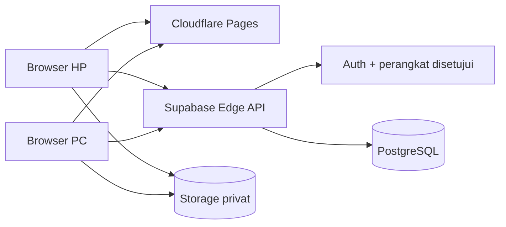

# Deploy Cardrove sendiri

Satu instalasi untuk satu pemilik, dengan beberapa perangkat yang memakai deck dan progress bersama. Setiap orang yang menyalin repo membuat proyek Supabase dan Pages sendiri. Pembuat Cardrove tidak mengoperasikan server pusat.

Panduan lengkap tersedia di [handbook Cardrove](https://ardanngrha.github.io/cardrove/docs/). Identifier database versi awal dipertahankan agar koleksi tetap kompatibel. API aktif, file backup baru, dan tampilan memakai nama Cardrove.

## Layanan

- Cloudflare Pages menyajikan frontend Svelte/Vite sebagai file statis.
- Supabase PostgreSQL menyimpan deck, catatan, progress FSRS, pengaturan, dan daftar perangkat.
- Supabase Auth menyimpan sesi perangkat. Pengguna menghubungkan perangkat sekali lewat kode/QR; tidak perlu email/password harian. Backend membuat identitas internal per perangkat. Kredensial internal tidak diberikan ke frontend.
- Edge Function `cardrove-api` memeriksa sesi dan persetujuan perangkat sebelum setiap operasi. Perubahan review memakai transaksi, versi progress dan ID operasi. Database dan Storage juga menerapkan akses per perangkat.
- Bucket Storage bersifat privat dan dikelola migrasi. Media dibuka melalui tautan sementara selama 10 menit.



## 1. Siapkan Supabase Free

Buat proyek Free di organisasi Free. Jangan memilih upgrade atau add-on berbayar. Catat project ref, URL API, dan publishable key dari dashboard. Kunci publishable memang tersedia di frontend; **jangan memasukkan secret key/service_role ke variabel VITE_**.

Dengan Supabase CLI yang sudah terpasang:

```sh
supabase login
supabase link --project-ref YOUR_PROJECT_REF
supabase db push
supabase functions deploy cardrove-api --no-verify-jwt
```

Migrasi ada di `supabase/migrations`. `--no-verify-jwt` diperlukan karena endpoint pairing pertama belum mempunyai sesi. Function tetap memverifikasi bearer token dan daftar perangkat di dalam handler untuk setiap endpoint privat. Jangan menghapus pemeriksaan itu. Default server-side environment Supabase sudah menyediakan kunci administratif bagi function, sehingga tidak perlu menyalinnya ke repo.

Alternatif MCP: terapkan setiap migrasi berurutan, lalu deploy function beserta `deno.json`, import map tersebut, dan `verify_jwt=false`.

## 2. Konfigurasi frontend

```sh
npm ci
cp .env.example .env.cloud.local
```

Isi `.env.cloud.local`:

```dotenv
VITE_BACKEND=supabase
VITE_SUPABASE_URL=https://YOUR_PROJECT_REF.supabase.co
VITE_SUPABASE_PUBLISHABLE_KEY=YOUR_PUBLISHABLE_KEY
```

```sh
npm run dev:cloud
```

Mode lokal Node/SQLite tetap tersedia melalui `npm run dev`. Mode cloud tidak memerlukan server Express yang selalu menyala.

## 3. Deploy Pages

Gunakan akun Cloudflare Free. Pilih Git integration jika ingin setiap perubahan repo otomatis dideploy, atau Direct Upload untuk mengunggah hasil build.

- Build command: `npm run build:cloud`
- Output directory: `dist`
- Node version: 24 atau lebih baru
- Environment: tiga variabel `VITE_` di atas, untuk production dan preview yang dibutuhkan.
- Gunakan subdomain `.pages.dev` gratis.

Untuk Direct Upload, setelah Cloudflare CLI terpasang dan login:

```sh
npm run build:cloud
npx wrangler pages deploy dist --project-name cardrove
```

Gunakan nama proyek unik bila `cardrove` sudah dipakai. `wrangler.toml` menyediakan konfigurasi output. Tidak ada Pages Function, Workers berbayar, R2, atau layanan berbayar lain yang dibutuhkan.

## 4. Hubungkan perangkat pertama

```sh
npm run setup:cloud -- --app-url https://YOUR_APP.pages.dev
```

Ganti URL contoh dengan alamat aplikasi hasil deploy. Perintah ini membuat tautan secara lokal di `work/setup/setup-link.txt`, SQL di `work/setup/setup.sql`, dan kode cadangan di `work/setup/connect-code.txt`. Cloudflare tidak membuat tautan ini otomatis.

Jalankan `setup.sql` melalui SQL Editor proyek Supabase milikmu, lalu buka tautan dari `setup-link.txt`. Aplikasi langsung menghubungkan perangkat pertama dan membuka form nama pengguna dan workspace. Setelah itu, simpan kode akses tetap yang dibuat aplikasi. Tautan setup berlaku sekali selama 30 menit sejak SQL dijalankan.

File setup diabaikan Git dan hanya bisa dibaca pemilik file. Jalankan perintah ini di komputer pemilik, bukan log CI publik. Jangan membagikan tautan, kode setup, atau QR pairing. Untuk perangkat berikutnya, gunakan kode akses tetap atau kode sementara dari Pengaturan.

Bootstrap hanya bekerja bila belum ada perangkat aktif. Setelah terhubung, isi nama pemilik dan workspace. Salin atau unduh kode akses tetap, lalu konfirmasi bahwa kode sudah disimpan. Kode tetap berlaku sampai diganti melalui Pengaturan. Untuk perangkat lain, gunakan kode tetap tersebut atau QR sementara yang berlaku lima menit.

Jika semua perangkat dan kode akses hilang, buat SQL pemulihan. Deck dan progress tetap tersimpan. SQL ini membatalkan kode akses lama dan memutus semua perangkat.

```sh
npm run setup:cloud -- --app-url https://YOUR_APP.pages.dev --recover
```

Tinjau dan jalankan SQL yang dihasilkan melalui dashboard Supabase pemilik, lalu gunakan kode setup baru. Jangan bagikan file setup. Di Pengaturan, pemilik juga bisa mengganti nama workspace atau mereset jadwal dan riwayat belajar dengan mengetik nama workspace sebagai konfirmasi. Deck, catatan, dan media tidak dihapus saat reset.

## Pasang di layar utama

iPhone/iPad: Safari → Bagikan → Tambahkan ke Layar Utama. Aktifkan Buka sebagai App Web bila tersedia. Android: menu Chrome → Instal aplikasi atau Tambahkan ke layar utama. Ikon C dan mode aplikasi mandiri sudah disediakan. Belajar tetap memerlukan koneksi; data privat tidak disimpan oleh service worker. Instalasi di luar localhost membutuhkan HTTPS.

## Alur impor dan belajar

1. Browser membuka APKG di Web Worker. SQLite/WASM membaca notes, template, cards, dan referensi media.
2. File diperiksa, media di-hash, dan batas ukuran divalidasi. Data dikirim bertahap; empat unggahan media dapat berjalan bersamaan.
3. Pekerjaan import disimpan di server. Jika terputus, pilih ulang file yang sama; media yang telah tersimpan dilewati.
4. Deck baru diaktifkan dalam satu transaksi setelah jumlah records dan seluruh objek media diperiksa. Pengimporan ulang mempertahankan progress.
5. Rating dihitung FSRS di backend. Versi progress mencegah dua perangkat menimpa kartu yang sama. ID operasi membuat pengiriman ulang aman.
6. Antarmuka mengambil data lagi saat kembali ke aplikasi. Ini memerlukan koneksi; belum ada mode offline atau sinkronisasi AnkiWeb.

## Backup dan pemulihan

Pengaturan → Unduh backup lengkap menghasilkan `.cardrove.zip`: snapshot deck/catatan/template, progress, semua riwayat termasuk undo, pengaturan dan media. Sesi dan kode perangkat tidak disertakan. Snapshot metadata diambil dalam satu query database agar review yang sedang berjalan tidak mencampur state.

Pulihkan melalui Pengaturan di instalasi **tanpa kartu** yang sudah memiliki perangkat pemilik. Browser memeriksa hash media, mengunggah bertahap, lalu mengaktifkan data dan progress dalam satu transaksi. Pemulihan ke koleksi berisi kartu ditolak untuk menghindari penggantian progress tanpa sengaja. Riwayat yang dipulihkan diatribusikan ke perangkat pemulih.

Batas backup lewat browser adalah 450 MB media dan 64 MB metadata; perangkat dengan RAM kecil mungkin membutuhkan koleksi lebih kecil. Backup dan restore memerlukan koneksi dan menghabiskan kuota transfer. Untuk koleksi lebih besar, gunakan dump PostgreSQL dan backup Storage melalui alat Supabase. Free tidak menyediakan backup otomatis yang dapat diandalkan untuk pemulihan pribadi: unduh backup sendiri secara berkala.

## Batas Free dan aplikasi

Diperiksa 16 Oktober 2026; penyedia bisa mengubah paket. [Supabase pricing](https://supabase.com/pricing) dan [Pages limits](https://developers.cloudflare.com/pages/platform/limits/) menjadi acuan terbaru.

| Bagian     | Paket Free / batas aplikasi                                                                                                                       |
| ---------- | ------------------------------------------------------------------------------------------------------------------------------------------------- |
| Database   | Supabase 500 MB per proyek; ukuran termasuk indeks dan data internal. Tidak ada meter database langsung dalam UI saat ini.                        |
| Media      | Supabase 1 GB; Cardrove menolak import bila estimasi penggunaan melebihi 900 MB.                                                                  |
| File media | Maksimum 50 MB per objek.                                                                                                                         |
| Transfer   | Supabase 5 GB egress + 5 GB cached egress; semua browser memakai kuota proyek yang sama.                                                          |
| Edge API   | 500.000 invocation termasuk dalam Free.                                                                                                           |
| Proyek     | Maksimum dua proyek Free aktif; dapat dijeda setelah satu minggu tidak aktif.                                                                     |
| Frontend   | Pages Free 500 build/bulan, 20.000 file, maksimum 25 MiB per asset. Deck/media berada di Supabase, sehingga bukan asset Pages.                    |
| Import     | APKG ≤512 MB, database hasil pembongkaran ≤256 MiB, ≤100.000 kartu per file, ≤10.000 objek media unik. RAM browser bisa menjadi batas lebih awal. |

Saat kuota habis, gunakan dashboard untuk menilai pemakaian, kurangi koleksi, atau tunggu reset kuota yang berlaku. Aplikasi tidak melakukan upgrade otomatis. Batas aplikasi 900 MB mencakup media import terputus; membatalkan import menghapus staging records tetapi tidak otomatis menghapus objek media yang telah diunggah. Pembersihan objek yatim dilakukan pemilik melalui Storage dashboard setelah memeriksa bahwa objek tidak dipakai deck atau import aktif.

Satu instance berarti satu pemilik: jangan membagikan kode pairing ke orang yang seharusnya tidak mendapat seluruh deck dan progress. Pencabutan perangkat menghentikan akses baru; media yang sudah diunduh tidak dapat ditarik kembali dan signed URL yang masih berlaku bertahan maksimal 10 menit.

Tidak mendukung JavaScript kartu, Image Occlusion, add-on, LaTeX, nested cloze kompleks, atau seluruh filter Anki. Template disanitasi dan dirender dalam iframe tanpa script. Atribusi dan lisensi deck tetap mengikuti pembuatnya; repo tidak menyertakan deck Jepang pribadi atau database pengguna.

## Upgrade bucket media versi lama

Instalasi baru berakhir dengan bucket privat `cardrove-media`. Untuk instalasi lama yang masih memiliki file di `myanki-media`, migrasi aktivasi sengaja berhenti sampai salinan lengkap tersedia. Jangan mengedit metadata `storage.objects` untuk memindahkan file.

1. Login dengan CLI Supabase resmi. Terapkan migrasi sampai `prepare_cardrove_media`, lalu hentikan import selama pemindahan.
2. Jalankan `node scripts/migrate-media-bucket.mjs --project-ref YOUR_PROJECT_REF`. Script memakai login CLI untuk mendapatkan akses administratif proyek di memori, menyalin melalui Storage API, mencocokkan nama/ukuran/MIME semua file, dan membandingkan byte sampel audio/gambar. Kunci tidak dicetak atau disimpan.
3. Jalankan `supabase db push` kembali. Migrasi aktivasi menolak pergantian jika salinan belum lengkap, lalu mengganti referensi dan kebijakan bucket secara atomik.
4. Reload perangkat yang terhubung. Setelah memverifikasi app dan media, jalankan `node scripts/migrate-media-bucket.mjs --project-ref YOUR_PROJECT_REF --cleanup` untuk memeriksa ulang salinan dan menghapus bucket lama beserta objeknya melalui Storage API.

Gunakan `SUPABASE_CLI` untuk menentukan lokasi executable CLI jika tidak ada di PATH. Jangan menjalankan migrasi administratif ini di browser atau CI publik. Script tidak mengganti nama tabel database maupun menghapus deck atau progress.
